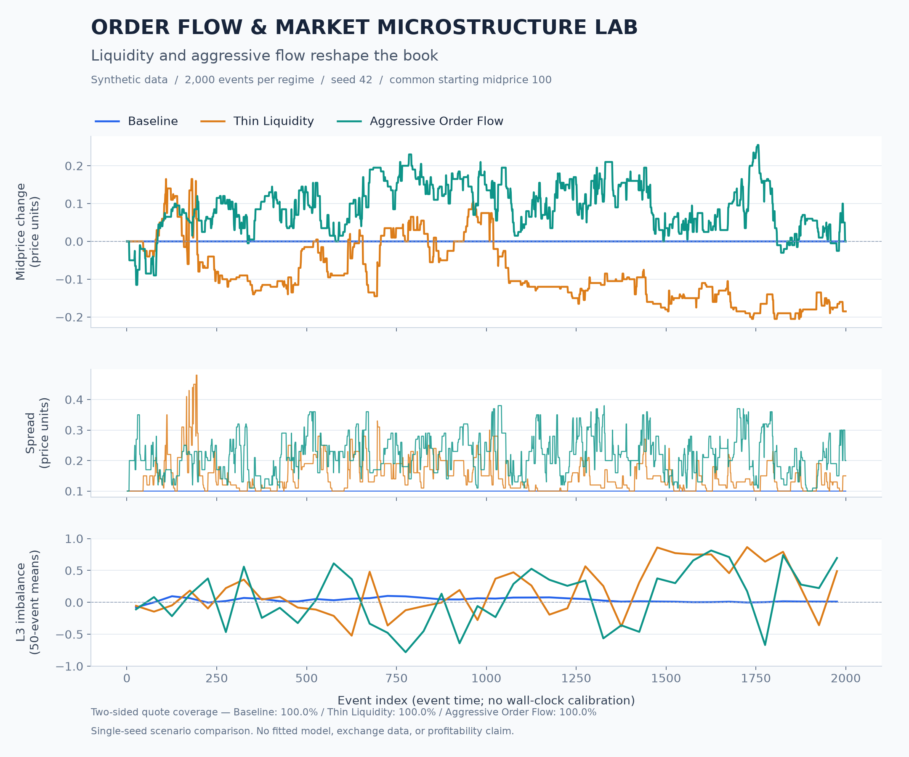
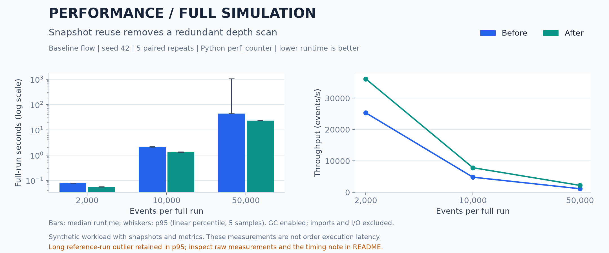
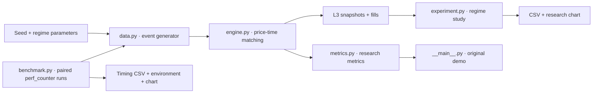

# ORDER FLOW & MARKET MICROSTRUCTURE LAB

*Event-Driven Limit Order Book | Liquidity Analysis | Performance Benchmarking*

An event-driven Python limit order book with price–time priority, FIFO execution and reproducible liquidity scenarios. The lab connects order-level mechanics to observable spread, midprice and imbalance dynamics, with measured performance and explicit model limitations.



| Verified locally | Result |
| :--- | :--- |
| Liquidity scenario comparison | 3 regimes × 2,000 events; seed 42 |
| Price dynamics under stress | 1.4564 bp/event volatility vs 0 in baseline |
| Full-run throughput | 2,197 events/s at 50,000 events |
| Automated checks | 28 tests; before/after economic output hashes match |

## Performance



| Events | Before median / p95 (s) | After median / p95 (s) | Before → after events/s | Paired median speedup |
| ---: | ---: | ---: | ---: | ---: |
| 2,000 | 0.0789 / 0.0794 | 0.0553 / 0.0557 | 25,341 → 36,172 | 1.43× |
| 10,000 | 2.0797 / 2.1867 | 1.2765 / 1.3434 | 4,808 → 7,834 | 1.66× |
| 50,000 | 44.0160 / 1035.6445 | 22.7537 / 24.3633 | 1,136 → 2,197 | 1.88× |

**Timing anomaly retained.** One 50,000-event reference run took 1,283.3442 s; the other four took 29.3847–44.8455 s. Its cause was not established (host scheduling or suspension is possible). It remains in the raw CSV and the 1,035.6445 s reference p95; no observation was discarded. Paired median speedup limits this single sample's influence, but these non-isolated-machine measurements are not a controlled hardware benchmark.


Throughput is event count divided by median full-run wall-clock time. Speedup is the median of the five paired before/after runtime ratios; it can differ from the ratio of the two runtime medians. These measurements describe **full-run runtime**; exchange order execution latency is not measured.

**Measurement conditions.** CPython 3.13.5, Intel Core i7-14650HX, Windows 11 (build 26200), NumPy 2.5.4. Baseline flow, seed 42, 2,000 / 10,000 / 50,000 events, five repeats per size and version. One untimed 2,000-event warmup per version; paired versions alternate execution order each repeat. Timing uses `time.perf_counter()` in one process with GC enabled; explicit GC collection runs before each timed call. The timed region includes book initialization, event generation, matching, snapshots and metric histories. Imports, output hashing, object destruction, plotting and file I/O are outside it. CPU affinity and clock frequency are not controlled; background load can affect results.

Median and p95 describe **whole-run duration**. p95 uses NumPy's linear percentile interpolation on five observations: useful as a descriptive spread measure, not a reliable tail-latency estimate. Raw wall-clock measurements and per-repeat throughput are retained in [benchmark_runs.csv](results/benchmark_runs.csv), with [summary](results/benchmark_summary.csv) and [environment metadata](results/benchmark_environment.json).

**Bottleneck and one optimization.** A reference-path cProfile run at 10,000 events identified repeated FIFO quantity summation in `LimitOrderBook.depth()` as the dominant cost. Each event already builds an L3 snapshot, then the original imbalance calculation scans those queues again. Reusing snapshot quantities removes that second scan while leaving the matching engine untouched. Measured paired median speedups were 1.43× / 1.66× / 1.88× at 2,000 / 10,000 / 50,000 events respectively. The growing passive queues still require a depth scan for every snapshot, so throughput declines with run size; the algorithm has not become constant-time.

The benchmark retains the original calculation via `reuse_snapshot_metrics=False`, so the before/after comparison can be rerun from the same checkout. Every pair and repeat checks a SHA-256 digest of snapshots, metric histories, economic fill fields and the final book. Process-global order IDs are excluded. The [reference profile](results/benchmark_profile.txt) is collected separately and never used for timing.

## Market Microstructure Experiments

These experiments start at midprice 100 with ten seeded levels per side. Each run processes 2,000 events with seed 42.

| Regime | Limit quantity scale | Market-order probability | Market quantity scale | Market buy probability |
| :--- | ---: | ---: | ---: | ---: |
| Baseline | 1.00 | 7% | 1.0 | 50% |
| Thin Liquidity | 0.15 | 7% | 1.0 | 50% |
| Aggressive Order Flow | 1.00 | 25% | 2.0 | 55% |

The limit scale affects both seeded depth and arriving limit sizes; scaled quantities are truncated to integers, minimum one. Original quantities are uniform integers: seeded limits 5–49, arriving limits 1–29, market orders 1–19. Buy probability is conditional on a market order. Cancellations stay at 3%; remaining flow splits equally between limit bids and asks. Limit prices follow the original midprice-relative placement rule with 0.05 increments and two-decimal rounding.

| Regime | Trade fills | Mean spread | Net midprice change | Volatility (bp/event) | Mean L3 imbalance |
| :--- | ---: | ---: | ---: | ---: | ---: |
| Baseline | 212 | 0.100000 | +0.000000 | 0.000000 | +0.036163 |
| Thin Liquidity | 763 | 0.148820 | −0.185000 | 1.102978 | +0.182376 |
| Aggressive Order Flow | 1,080 | 0.216155 | +0.000000 | 1.456406 | +0.063829 |

Source: [full-precision regime summary](results/regime_summary.csv). Two-sided quote coverage is 100% in all three runs.

- **Baseline:** passive liquidity accumulation holds the midprice constant and reproduces the original 212 fills.
- **Thin Liquidity:** smaller resting quantities permit quote depletion and a net price decline in this seed.
- **Aggressive Order Flow:** more frequent, larger market orders produce wider spreads and greater price fluctuations. The final midprice returns to its starting value, despite nonzero volatility.

**Definitions.** A fill is one maker–taker match; one order can generate multiple fills. Spread is best ask minus best bid, in arbitrary price units, averaged after events. Net midprice change is final minus initial price. Volatility is the sample standard deviation (`ddof=1`) of simple adjacent-event midprice returns × 10,000, including the initial state and zero returns; it is not annualized. L3 imbalance is `(bid_qty − ask_qty) / (bid_qty + ask_qty)` over the best three levels on each side, averaged across events. The chart uses 50-event block means only for the imbalance panel.

The experiment uses raw snapshots: missing quotes become `NaN`, missing spreads are excluded and returns never bridge a quote gap. Final-price absence leaves net change unavailable; quote coverage and valid return counts are exported. The original demo retains its legacy history fallbacks.

## Engineering Highlights

- **Price–time priority:** marketable limits cross immediately; residual quantities rest at their limit price.
- **FIFO execution:** deques preserve arrival priority within each price; market orders sweep opposite levels.
- **Liquidity inspection:** best quotes, depth, cancellations and queue position with quantity ahead.
- **Microstructure metrics:** spread, midprice, book imbalance, quantity-weighted microprice and signed aggressive flow.
- **Deterministic economic outputs:** seeded NumPy generator and configurable flow regimes; no network or datasets.
- **Automated testing:** 28 checks covering matching, FIFO, cancellation, metrics, deterministic scenarios, unavailable quotes and optimization equivalence, including a depleted book.

## System Architecture



The generator owns event orchestration and history collection; the matching engine remains independent of reporting. Snapshot reuse affects only the generator's imbalance calculation. Shared report styling lives in `lob_sim/report_style.py`.

## Quickstart

From the project root in Windows PowerShell, reuse the existing `.venv`. For a fresh checkout, first run `python -m venv .venv` and `.\.venv\Scripts\python.exe -m pip install -r requirements.txt`.

```powershell
# Rebuild the three-regime CSV and hero chart.
.\.venv\Scripts\python.exe experiment.py

# Measure both paths, verify outputs, and rebuild benchmark artifacts.
.\.venv\Scripts\python.exe benchmark.py

# Run all automated checks without writing pytest's cache.
.\.venv\Scripts\python.exe -m pytest tests/ -v -p no:cacheprovider

# Original single-run CLI.
.\.venv\Scripts\python.exe -m lob_sim --n-events 2000 --seed 42 --plot lob_study.png
```

The benchmark performs 30 measured runs, plus warmups and a separate profile; allow several minutes on comparable hardware. It fails if paired economic outputs differ. Both scripts write to `results/` relative to the project, independent of the shell's current directory. On macOS/Linux use `.venv/bin/python`. Dependencies remain NumPy, pandas, Matplotlib and pytest; nothing new is installed. Tested versions are recorded with the benchmark, but requirements are not pinned.

## Limitations

- **Model dynamics:** the reported experiments use a seeded event generator without empirical calibration, calibrated arrival times, latency, fees or an adverse-selection model. Price placement is anchored to the current midprice rather than a fundamental value; prices are floats rather than integer exchange ticks.
- **Limited research inference:** one seed per regime demonstrates mechanics, not predictive validity. Regimes change multiple parameters; equal seeds do not guarantee paired event streams because branches consume different random draws.
- **Simplified cancellation:** sampling previously submitted limit IDs can target filled orders; initial seeded orders are excluded from cancellation selection.
- **Scaling and parameter range:** depth calculations scan growing FIFO queues. The implementation prioritizes inspectable mechanics over production throughput. Extreme settings can empty the book or leave the placement rule's useful positive-price range.
- **No demonstrated trading profitability:** no trained ML model, implemented trading strategy, backtest profitability or HFT latency claim. The forward-return unit test uses a constructed trend to check arithmetic.
- **Reproducibility scope:** economic outputs are deterministic in the tested environment; timing depends on machine load, and floating-point/rendered outputs may vary with dependency versions.

## Credits & License

The base matching engine and original simulator originate from [JoshRiang/limit-order-book-simulator](https://github.com/JoshRiang/limit-order-book-simulator), authored by **Joshua Riangkamang**.

This extension adds configurable liquidity and flow scenarios, comparative research metrics and visualizations, paired performance benchmarking, one snapshot-reuse optimization and correctness checks. The original matching engine is preserved.

The original [MIT License](LICENSE), including its copyright notice, remains unchanged.
